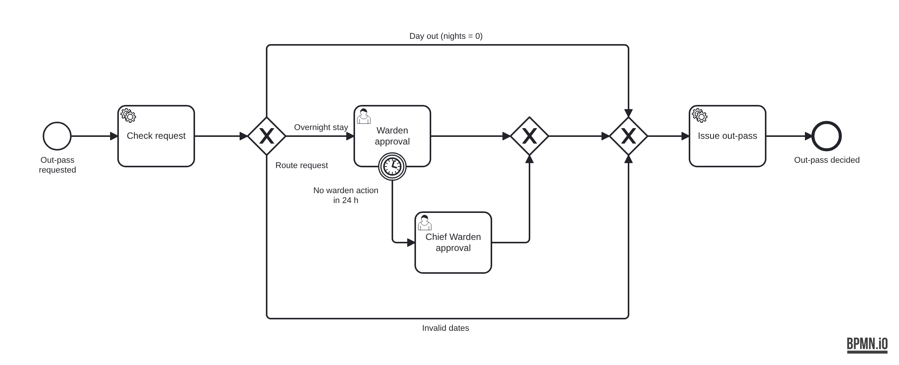

# Exercise 5 — Hostel Out-Pass Request (Camunda 8 SaaS + Spring Boot)

**Ram Prasath N · RA2411026011139 · 21CSE735P Workflow Automation Engineering**

SRM hostel students need an out-pass to leave campus. This project automates the request on a Camunda 8.8 SaaS cluster. The BPMN model runs in the cluster; all business logic runs in a Spring Boot app on the laptop that talks to the cluster outbound only (REST call starts the process, job workers poll for work).



## Process rules

1. The student submits `POST /outpass` with `studentName`, `regNo`, `hostelBlock`, `outDate`, `returnDate`, `parentPhone`, `purpose`.
2. **Check request** (service task, type `check-outpass`) computes `nights` and sets `valid = false` when the return date is before the out date.
3. **Route request** (exclusive gateway):

   | Flow | Condition | Goes to |
   |---|---|---|
   | Invalid dates | `=not(valid)` | straight to Issue out-pass → REJECTED |
   | Day out | `=valid and nights = 0` | auto-approved, straight to Issue out-pass |
   | Overnight stay | `=valid and nights >= 1` | **Warden approval** user task (form `warden-approval-form`) |

4. **Issue out-pass** (service task, type `issue-outpass`) creates pass number `OP-<regNo>-<outDate>` for approved requests and logs the "SMS to parent" with the decision.
5. The process ends with `passStatus = ISSUED` or `REJECTED`.

**Bonus — 24 h escalation.** An interrupting timer boundary event sits on Warden approval. If the warden does not act within 24 hours, the warden task is cancelled and the request moves to **Chief Warden approval** (form `chief-warden-approval-form`). The duration defaults to `PT24H`; a single request can pass `"escalateAfter": "PT2M"` so the escalation can be demonstrated in two minutes instead of a day.

## IDs that must match between model and code

| In the model | Value | In the code |
|---|---|---|
| Process ID | `hostel-outpass` | `bpmnProcessId(PROCESS_ID)` in `OutpassController` |
| Task type | `check-outpass` | `@JobWorker(type = "check-outpass")` |
| Task type | `issue-outpass` | `@JobWorker(type = "issue-outpass")` |
| Form IDs | `warden-approval-form`, `chief-warden-approval-form` | form files listed in `@Deployment` |
| Form field keys | `approved`, `wardenRemarks` | `@Variable` names in `issueOutpass` |

## Project layout

```
.
├─ pom.xml                                  Spring Boot 3.5.6, camunda-spring-boot-starter 8.8.15
├─ camunda-credentials.example.yaml         copy to camunda-credentials.yaml (git-ignored)
├─ requests/                                JSON bodies for the test cases
├─ docs/                                    diagram + screenshots
└─ src/main/
   ├─ java/edu/srmist/outpass/
   │  ├─ OutpassWorkflowApplication.java    @SpringBootApplication + @Deployment
   │  ├─ api/OutpassController.java         POST /outpass starts an instance
   │  ├─ api/OutpassRequest.java            request body
   │  └─ worker/OutpassWorkers.java         check-outpass, issue-outpass
   └─ resources/
      ├─ application.yaml                   SaaS connection (no secrets)
      └─ bpmn/hostel-outpass.bpmn, warden-approval.form, chief-warden-approval.form
```

## Run it

**Prerequisites:** JDK 17 or later, Maven 3.9+ (or IntelliJ's bundled Maven), a Camunda 8.8 SaaS cluster.

1. **Console** → Clusters → create a cluster on the 8.8 generation and wait for *Healthy*. Open it → **API** → *Create new client* named `outpass-app` with the **Zeebe / Orchestration Cluster** scope. Copy Client ID, Client Secret, Cluster ID and Region from the *Spring Boot* tab.
2. Add the credentials (PowerShell, in the project folder where `pom.xml` is):
   ```powershell
   Copy-Item camunda-credentials.example.yaml camunda-credentials.yaml
   notepad camunda-credentials.yaml
   ```
   This file is git-ignored. The same values can come from the environment variables `CAMUNDA_CLIENT_ID`, `CAMUNDA_CLIENT_SECRET`, `CAMUNDA_CLUSTER_ID`, `CAMUNDA_CLUSTER_REGION` instead.
3. Start the app — IntelliJ: open `pom.xml` as a project and run `OutpassWorkflowApplication`; or in a terminal:
   ```powershell
   mvn spring-boot:run
   ```
   The log shows the deployment of `hostel-outpass` and both forms. No manual deploy from Modeler is needed.
4. Optional: in **Web Modeler** create a project, upload the `.bpmn` and both `.form` files from `src/main/resources/bpmn/`, and confirm the Problems panel is empty.

## Test cases

Run from the project folder (PowerShell uses `curl.exe`, macOS/Linux use `curl`):

```powershell
curl.exe -X POST http://localhost:8080/outpass -H "Content-Type: application/json" --data "@requests/day-out.json"
```

| Request | Dates | Path in Operate | Result |
|---|---|---|---|
| `requests/day-out.json` | 20 Oct → 20 Oct (0 nights) | Day out → Issue out-pass | `ISSUED`, `OP-RA2411026011139-2026-10-20` |
| `requests/overnight.json` | 24 Oct → 26 Oct (2 nights) | Warden approval → Issue out-pass | `ISSUED` after the warden approves in Tasklist |
| `requests/invalid.json` | 25 Oct → 22 Oct | Invalid dates → Issue out-pass | `REJECTED`, no warden involved |
| `requests/escalation-demo.json` | 31 Oct → 2 Nov, `escalateAfter: PT2M` | Warden approval → timer → Chief Warden approval | decided by the Chief Warden |

For the overnight case: **Tasklist** → open *Warden approval* → *Assign to me* → tick *Approve this out-pass*, add a remark → *Complete task*. For the escalation case, leave the warden task alone for two minutes; the task moves to *Chief Warden approval*.

Unit tests for the worker logic and request validation run without a cluster: `mvn test`.

## Screenshots

| Screenshot | File |
|---|---|
| Operate — auto-approved instance (day out) | `docs/screenshots/operate-auto-approved.png` |
| Operate — warden-approved instance | `docs/screenshots/operate-warden-approved.png` |
| Operate — rejected instance (invalid dates) | `docs/screenshots/operate-rejected.png` |
| Tasklist — warden form | `docs/screenshots/tasklist-warden-form.png` |
| Operate — escalated to Chief Warden (bonus) | `docs/screenshots/operate-escalated.png` |


## Variable note

The REST controller turns the request body into the starting variables: `studentName`, `regNo`, `hostelBlock`, `outDate`, `returnDate`, `parentPhone`, `purpose`, and `escalateAfter` (`PT24H` unless the request overrides it). It rejects a missing field or a date not in `yyyy-MM-dd` with HTTP 400 before any instance is created.

| Step | Reads | Writes |
|---|---|---|
| `check-outpass` worker | `regNo`, `outDate`, `returnDate` | `nights` (return date − out date, in days), `valid` (false if return is before out), `approved` (true only for a valid day out) |
| Route request gateway | `valid`, `nights` | — |
| Warden / Chief Warden form | shows `studentName`, `regNo`, `hostelBlock`, `outDate`, `returnDate`, `nights`, `purpose`, `parentPhone` | `approved` (checkbox), `wardenRemarks` (text area) |
| Escalation timer | `escalateAfter` | — |
| `issue-outpass` worker | `studentName`, `regNo`, `outDate`, `parentPhone`, `approved`, `wardenRemarks` | `passStatus` (`ISSUED` / `REJECTED`), `passNumber` (`OP-<regNo>-<outDate>`, or null when rejected) |

`approved` is written twice on the overnight path: `check-outpass` sets it to false, then the warden's form overwrites it with the decision. On the day-out and invalid paths the value from `check-outpass` is final, which is why `issue-outpass` can run unchanged on every path and simply reads `approved`. `wardenRemarks` exists only when a warden or the Chief Warden acted, so the worker treats it as optional.

## Troubleshooting

| Symptom | Fix |
|---|---|
| 401 / token error at start-up | Wrong client ID or secret, or the client lacks the Zeebe / Orchestration Cluster scope. Recreate the client. |
| UNAVAILABLE / cannot connect | Wrong `cluster-id` or `region`. Do not set `grpc-address` / `rest-address` in SaaS mode. |
| Instance stuck at a service task | The app is not running, or a task type was edited in Modeler. |
| User task shows no form | The `.form` file is missing from `@Deployment` or its ID changed. |
